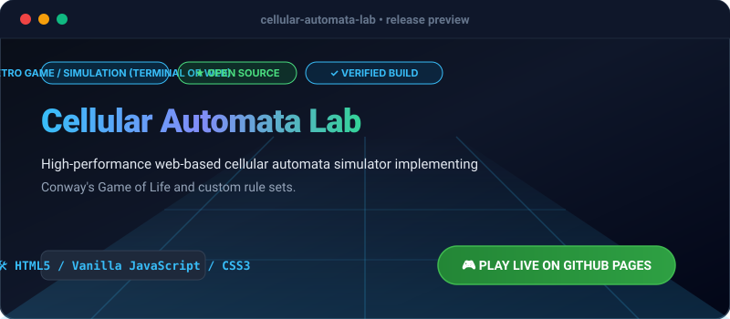

# Cellular Automata Lab

[](https://olamideakinade.github.io/cellular-automata-lab/)
[](https://github.com/Olamideakinade/cellular-automata-lab)
[](https://opensource.org/licenses/MIT)



> 🚀 **Live Demo Available:** Test and play this project live right now: **[https://olamideakinade.github.io/cellular-automata-lab/](https://olamideakinade.github.io/cellular-automata-lab/)**

Cellular Automata Lab is a lightweight, zero-dependency browser application for simulating discrete dynamical systems. Built directly on the HTML5 Canvas API, it supports real-time pan/zoom, custom Moore and von Neumann neighborhood rule formulation, and preset pattern loading.

## Key Capabilities

- **High-Performance Grid Rendering**: Offloads cell state updates to typed arrays (`Uint8Array`) to minimize garbage collection overhead during dense simulation steps.
- **Configurable Rule Engine**: Supports arbitrary Birth/Survival (B/S) rule strings (e.g., standard Conway `B3/S23`, Seeds `B2/S`, HighLife `B36/S23`).
- **Viewport Controls**: Smooth mouse-driven panning and zooming with integer grid snapping at high magnifications.
- **Preset Library**: Instant loading of classical patterns including blinkers, gliders, gosper glider guns, and oscillators.
- **State Persistence**: Serializes custom grid states and simulation parameters to `localStorage`.

## Quickstart

Clone the repository and serve the root directory using any static file server:

```bash
git clone https://github.com/Olamideakinade/cellular-automata-lab.git
cd cellular-automata-lab
python3 -m http.server 8080
```

Open `http://localhost:8080` in a modern browser.

## Architecture & Design

The codebase is intentionally partitioned into decoupled modules without external frameworks:

- `index.html`: Structural markup, control panel layout, and canvas viewport element.
- `style.css`: Minimalist design system implementing a dark-mode interface with CSS custom properties.
- `app.js`: Encapsulates the simulation loop, viewport transformations, event handling, and state management.

## License

MIT